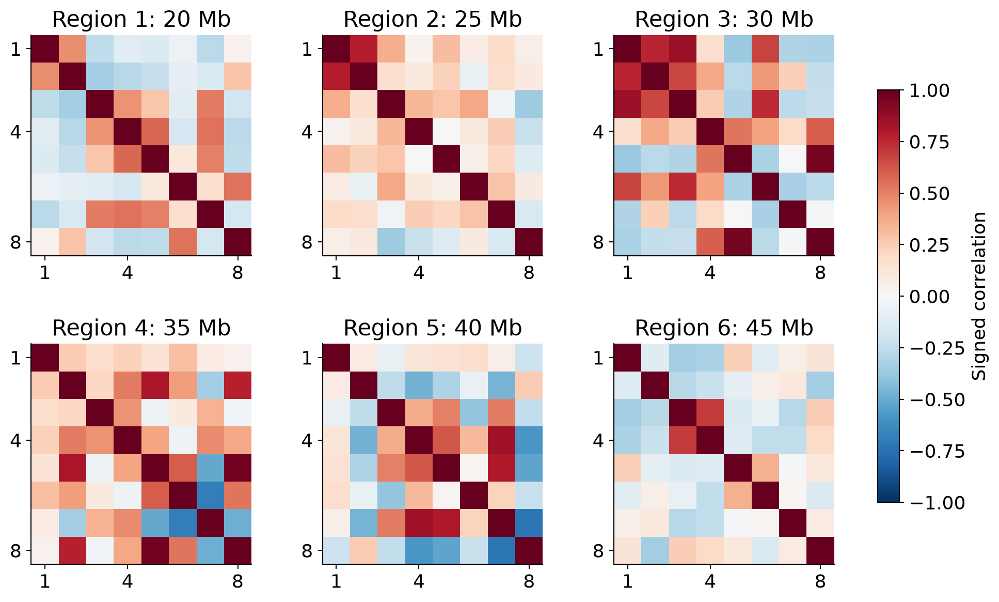
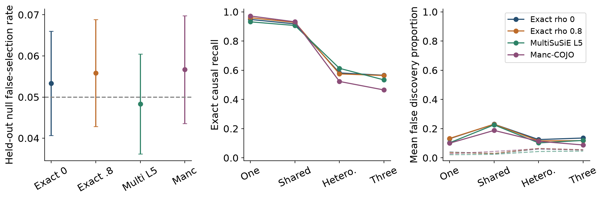
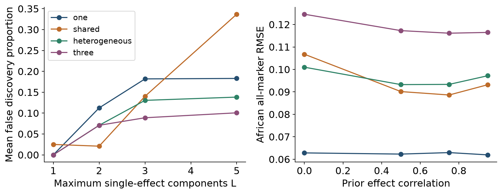
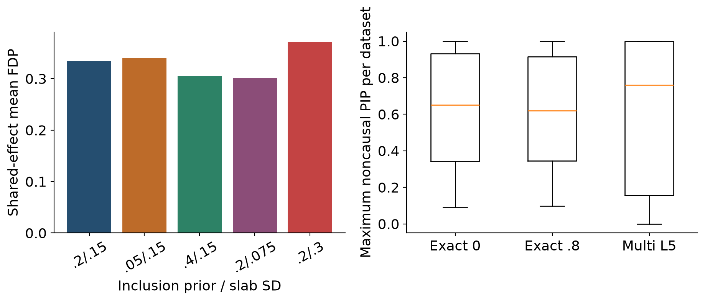
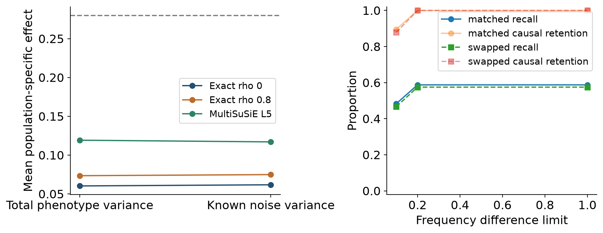
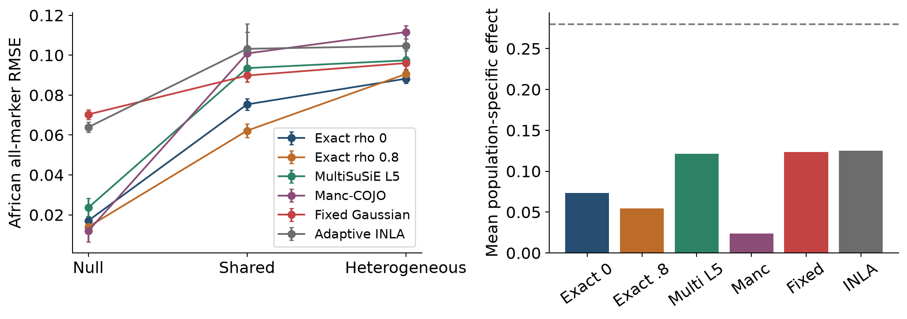
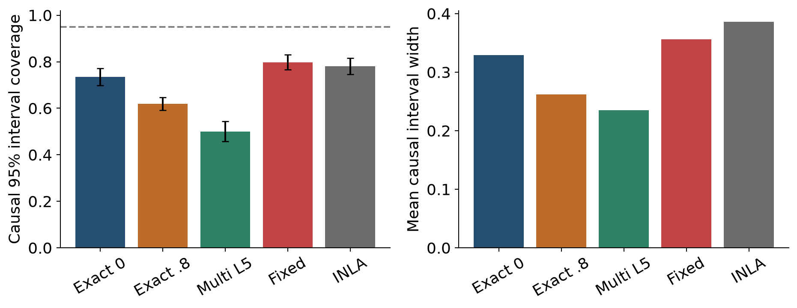

# Calibration LD sensitivity and adaptive Bayesian effect estimation in simulated multiancestry GWAS

**Vusumuzi Mabasa**

**A public reference simulation study with independent validation of R INLA**

This is a simulation study. Public 1000 Genomes haplotypes provide local genetic structure; study participants are resampled haplotype pairs and every phenotype is simulated. No AWI-Gen data or observed clinical outcomes were analysed. YRI and LWK are specific reference populations, not representations of African genetic diversity.

[Word manuscript](report/Multiancestry_GWAS_Methodology_and_Results.docx) · [Frozen protocol](revision/protocol.json) · [Primary results](results/revision/validation_summary.tsv) · [Sensitivity results](results/revision/sensitivity_summary.tsv) · [Baseline audit](results/revision/baseline_gate.json) · [INLA validation](results/revision/inla/validation.json)

## Abstract

**Background.** Multiancestry association procedures differ in their selection objectives and borrowing assumptions. Similar error rates under a global null do not guarantee similar false discovery proportions or unbiased effects when signals are present.

**Methods.** Six prespecified chromosome 22 regions supplied eight quality-controlled variants each from disjoint CEU, YRI and LWK study-generating and external-reference donor pools. A paired sensitivity experiment examined prior specification, MultiSuSiE architecture, residual variance, LD source and frequency filtering. Independent-seed validation compared exact shared-inclusion Bayesian models, published MultiSuSiE and the official Manc-COJO executable in one-, two- and three-causal-variant settings. Only after the baseline numerical audit passed was an adaptive continuous Gaussian hierarchy fitted with R-INLA. Identical-prior Gaussian and quadrature calculations independently validated its posterior summaries.

**Results.** The baseline comprised 7,680 unique datasets: 3,200 calibration and 4,480 evaluation datasets. Fresh validation contributed 6,000 datasets, including 3,600 evaluations across 12 region–population strata. With matched external references, held-out null selection rates ranged from 0.048 to 0.057. In the shared-effect setting, MultiSuSiE L5 had recall 0.907 and mean FDP 0.226; its mean FDP was 0.024 with in-sample LD. For the population-specific effect of 0.28, its mean estimate was 0.130. R-INLA was validated on 24 fixed-prior and 48 adaptive-prior contexts before 1,440 primary adaptive fits; the matched-reference adaptive model had heterogeneous-effect all-marker RMSE 0.105 and causal interval coverage 0.781 on the prespecified common subset.

**Conclusion.** Sensitivity and validation results quantify model dependence rather than establish universal method superiority. Adaptive INLA did not reduce all-marker RMSE relative to the fixed Gaussian hierarchy in the shared and heterogeneous matched-reference scenarios. This continuous hierarchy estimates effects and uncertainty; it does not provide a validated variant-selection mechanism. Findings are conditional on synthetic traits and six sparse regions with fixed donor panels.

## Introduction

Population differences in allele frequencies and linkage disequilibrium (LD) complicate the transfer of genetic association evidence between cohorts. Conditional association methods target independent signals, whereas Bayesian fine-mapping models assign support to candidate causal variants. Effect priors can stabilize estimates in a smaller cohort, but their apparent benefit depends on inclusion assumptions, genetic architecture and the accuracy of external LD.

The preceding two-region experiment identified substantial nonnull false discovery proportions and attenuation of population-specific effects. It also used two MultiSuSiE components when two causal variants were simulated. These observations motivated the present protocol, frozen in version control before new phenotypes were generated. The objectives were to diagnose these weaknesses through paired sensitivity analyses, assess reproducibility across additional regions and independent random streams, and then evaluate an adaptive Gaussian hierarchy using independently validated R-INLA calculations.

Manc-COJO [1] and MultiSuSiE [2] are established comparators, not reimplementations. The present analysis is an independent small-region experiment and does not reproduce the genome-wide or real-data analyses in their original publications. INLA [5] is an inference algorithm for the specified hierarchy, not a newly invented fine-mapping method.

## Methods

### Public references and quality control

Phased GRCh37 Phase 3 chromosome 22 genotypes came from the public 1000 Genomes release [3]. Six 100 kb windows began at 20, 25, 30, 35, 40 and 45 Mb. Each population contributed 40 external-reference donors; the separate study-generating pools contained 59 CEU, 68 YRI and 59 LWK donors. Donors did not overlap between pools. Reference participant identifiers and raw genotypes are excluded from this repository.

Variants were restricted to complete phased PASS biallelic nonambiguous SNPs with minor allele frequency at least 0.05 in every population and donor pool. A coordinate-spaced traversal retained eight variants per window, rejecting haplotype pairwise squared correlations at least 0.95 and non-positive or near-singular diploid LD matrices. All selected diploid matrices had minimum eigenvalue greater than 0.00001. Signed LD, variant alleles, frequencies and numerical checks are published in the [reference results](https://github.com/Vusumuzi2Mabasa/Multiancestry_GWAS_Bayesian_Comparison/tree/main/results/revision/reference). These are sparse typed panels; they do not reconstruct dense regional LD or fine-mapping credible sets for the full sequence.

Study genotypes were formed by independently drawing two whole local haplotypes with replacement from each study-generating pool. This retains within-window haplotype structure but does not create new reference diversity, between-region LD, admixture or relatedness. Cohort sizes were fixed at 2,000 CEU and 250 YRI or LWK individuals. Population labels describe the source panels and are not covariates inferred from a diverse African cohort.

### Generating model and summary likelihood

For centered genotype matrix $X_k$ in population $k$, we generated

$$y_k=X_k\beta_k+\epsilon_k,\qquad \epsilon_k\sim N(0,I_{n_k}).$$

Effects are measured per additional alternate allele in residual standard-deviation units. The null had no nonzero effects. The one-causal architecture used marker 2 with effect 0.22 in both populations. Shared effects used markers 2 and 7, both 0.22 in both populations. Heterogeneous effects were $(0.22,0)$ in CEU and $(0.10,0.28)$ in the African-source cohort at those markers. The three-causal architecture used markers 2, 5 and 7, with CEU effects $(0.22,-0.16,0)$ and African-source effects $(0.10,-0.16,0.28)$. Thus a shared inclusion event permits population-specific zero effects.

Let $d_{jk}=X_{jk}^{T}X_{jk}$, $q_k=X_k^Ty_k$, and $R_k$ denote an analysis LD matrix. Marginal regression estimates $b_{jk}$, standard errors $s_{jk}$ and total sample phenotype variance $v_k$ recover the required quantities:

$$d_{jk}=\frac{(n_k-1)v_k}{(n_k-2)s_{jk}^{2}+b_{jk}^{2}},\quad q_{jk}=d_{jk}b_{jk},\quad Q_k=\operatorname{diag}(\sqrt{d_k})R_k\operatorname{diag}(\sqrt{d_k}).$$

We use the working summary likelihood

$$q_k\mid\beta_k\sim N(Q_k\beta_k,\sigma_k^2Q_k).$$

With in-sample LD, $Q_k=X_k^TX_k$; with external LD, this is a plug-in approximation and reference uncertainty is not integrated. Primary analyses fix $\sigma_k^2=v_k$, a null-model variance proxy, not an estimated true residual variance. The known-noise sensitivity fixes $\sigma_k^2=1$ as an oracle diagnostic, keeping $Q_k$ and $q_k$ unchanged. This isolates variance specification without supplying true effects to the estimators. For MultiSuSiE's sufficient-statistic interface, the supplied $Y^TY$ changes the fixed residual variance and the initial prior scale is adjusted to preserve its absolute initialization; the unchanged primary interface was tested against the published summary-statistic interface.

In-sample LD is an oracle diagnostic. Matched external LD uses CEU and the corresponding YRI or LWK reference pool. The swapped condition changes only the African-source reference to the other population. No empirical diagonal regularization was introduced because the selected matrices were positive definite.

### Exact shared inclusion models

For each of eight markers, a common inclusion indicator has prior $\gamma_j\sim\operatorname{Bernoulli}(\pi)$. If inactive, both effects are exactly zero. If active,

$$\begin{pmatrix}\beta_{j1}\\\beta_{j2}\end{pmatrix}\mid\gamma_j=1\sim N\left(0,\tau^2\begin{pmatrix}1&\rho\\\rho&1\end{pmatrix}\right).$$

The primary values are $\pi=0.2$, $\tau=0.15$ and $\rho=0$ or $0.8$. All 256 inclusion configurations are integrated analytically using Gaussian precision updates and normalized log marginal likelihoods. For active-set prior covariance $V_\gamma$, let $G_\gamma$ be the block-diagonal analysis cross-products divided by the population residual variances, and let $u_\gamma$ contain the active $q_k/\sigma_k^2$ entries. Then

$$H_\gamma=V_\gamma^{-1}+G_\gamma,\qquad m_\gamma=H_\gamma^{-1}u_\gamma.$$

$$\log\mathrm{BF}_\gamma=\tfrac12u_\gamma^TH_\gamma^{-1}u_\gamma-\tfrac12\log|V_\gamma|-\tfrac12\log|H_\gamma|.$$

Configuration weights are proportional to the Bayes factor multiplied by $\pi^{|\gamma|}(1-\pi)^{8-|\gamma|}$; the empty model has Bayes factor one. Exact enumeration is a computational strategy; it does not itself cause high FDP. Posterior means, variances and equal-tailed 95% intervals use the complete spike-and-normal mixture, including its atom at zero. Intervals are not approximated by a normal interval around a model-averaged mean.

### Published comparators and sensitivity experiment

MultiSuSiE uses its published implementation with primary maximum component count $L=5$ and effect correlation 0.75. It learns population-specific prior effect scales; residual variance estimation is disabled consistently with the working likelihood. The iteration budget is 200 and tolerance 0.001. Component counts $L=1,2,3,5$ and correlations $0,0.5,0.75,0.95$ are varied separately. The primary count is not the true number of causal variants. Its intervals are quantiles of the variational marginal mixture over component inclusion events, and remain approximate Bayesian intervals because the underlying posterior approximation is variational.

In this model, $\beta_k=\sum_{\ell=1}^L b_{k\ell}$, where each component selects one common marker across populations and gives it population-specific, correlated effect amplitudes. Variational coordinate updates learn component selection probabilities $\alpha_{\ell j}$ and effect scales. The marker PIP is $1-\prod_{\ell\in\mathcal A}(1-\alpha_{\ell j})$, where $\mathcal A$ excludes components whose learned prior variances are zero. This differs from the exact model's Bernoulli prior on every marker and enumeration over all inclusion configurations.

Manc-COJO v1.1.0 performs actual conditional and joint selection using signed LD. An independent control confirmed agreement with its PLINK BED interface. Before selection, a common variant panel requires the absolute difference between study and reference effect-allele frequency to meet the specified limit in both populations. The primary limit is 0.2; sensitivity limits are 0.1 and 1.0 with matched and swapped references. This explicit common-panel harmonization is not claimed to reproduce every software default. Retained causal and noncausal counts are reported, and recall always uses the original generating truth as denominator. Unselected effects are zero for all-marker estimation comparisons.

The paired sensitivity experiment used the 20 and 40 Mb windows with both African-source populations. Each of its four strata had 200 calibration nulls, 100 held-out nulls and 30 datasets per alternative. Thirty-five analysis arms covered LD source, total versus known-noise variance, the MultiSuSiE settings above, exact-model inclusion probabilities 0.05/0.2/0.4, slab SDs 0.075/0.15/0.3 and Manc frequency limits. Changes were examined one factor at a time around a stated primary setting, not as a full factorial search or a procedure for selecting the best method.

### Calibration and fresh validation

Within each stratum and analysis arm, 200 independent null simulations calibrated a locus false-selection target of 0.05. Bayesian scores were maximum PIP; the Manc entry score was minus the base-10 logarithm of the smallest inverse-variance meta-analysis P value among eligible variants. For calibration scores $S_1,\ldots,S_B$, we froze

$$c=S_{(h)},\qquad h=\lceil(B+1)(1-0.05)\rceil=191,\qquad \text{select only when }S>c.$$

Every threshold file was written and hashed before evaluation. The actual Manc procedure was rerun at the corresponding entry P threshold when entry was possible. A tested first-entry identity screened datasets with no eligible significant marginal entry; these are explicitly counted as analytical empty selections, not executable fits. Strict inequalities handle ties conservatively. Calibration errors stop an arm; finite nonconverged MultiSuSiE outputs are retained and flagged rather than removed from denominators.

The inverse-variance entry statistic is $Z_j=(\sum_k b_{jk}/s_{jk}^2)/\sqrt{\sum_k1/s_{jk}^2}$, with $P_j=2\Phi(-|Z_j|)$. It is used only for calibration and the verified empty-entry screen; all nonempty conditional selection paths and joint effect estimates come from the official Manc executable.

Different score scales are appropriate for different procedures. Global-null calibration targets $P(R>0\mid H_0)$ and does not imply $E[V/\max(R,1)]\leq0.05$ under alternatives. There is no genome-wide multiplicity correction or empirical GWAS threshold recommendation here.

Fresh validation used a separate master seed across all six regions and both African-source populations. Each of 12 strata contained 200 calibration nulls, 100 held-out nulls and 50 datasets per alternative, with eight primary arms combining four methods and in-sample/matched LD. Four additional regions therefore extend the earlier two-window design; six windows are still insufficient for genome-wide generalization. The seed namespaces, architectures, analysis settings and INLA subset were prespecified in [protocol.json](revision/protocol.json).

### Performance measures and uncertainty

Exact recall is the proportion of original causal variants selected; false discovery proportion is $V/\max(R,1)$. The joint causal set is the union of nonzero effects across populations. LD-aware recovery uses maximum one-to-one matching between selected and causal variants when the same variant is selected or study LD has $r^2\geq0.8$. One proxy cannot recover two causal variants. Population-specific LD-aware recovery is reported separately because LD differs by population; both use the joint causal set. These measures address related but distinct targets; Manc conditional signals are not equivalent to exact causal identification.

African-source effect RMSE is the square root of mean squared error across all eight markers. We separately report the mean and bias for the population-specific effect 0.28, plus interval coverage and width for causal and noncausal coefficients. Coverage denominators use nonzero effects in the relevant population. Manc post-selection standard errors are not treated as Bayesian credible intervals. Monte Carlo standard errors for an equally weighted average of $C$ fixed strata are $\sqrt{\sum_c s_c^2/B_c}/C$. Paired changes use within-dataset differences before this calculation. This quantifies simulation uncertainty conditional on fixed donor pools and frozen thresholds, not uncertainty over possible reference panels.

### Adaptive Gaussian hierarchy and INLA validation

INLA execution required a successful [baseline audit](results/revision/baseline_gate.json). The adaptive extension uses a region-level heterogeneity SD, not independent hyperparameters for every marker:

$$\beta_{jk}=\mu_j+\delta_{jk},\quad \mu_j\sim N(0,0.15^2),\quad \delta_{jk}\mid\omega\sim N(0,\omega^2).$$

We specify a penalized-complexity precision prior by $P(\omega>0.2)=0.05$, equivalently $p(\omega)=\lambda e^{-\lambda\omega}$ with $\lambda=-\log(0.05)/0.2$. The fixed Gaussian comparator uses $\omega=0.075$. These continuous priors provide neither point-mass inclusion probabilities nor validated causal-selection decisions. No CAR smoothing is applied: correlated genotypes do not imply similar causal effects.

For $Q_k=L_kL_k^T$, the summary likelihood becomes independent Gaussian observations,

$$\widetilde y_k=L_k^{-1}q_k/\sigma_k,\qquad \widetilde y_k\mid\beta_k\sim N(L_k^T\beta_k/\sigma_k,I).$$

R-INLA fits this whitened system through a sparse projection matrix with eight shared and sixteen population-deviation latent coefficients. Noise precision is fixed at one. The adaptive implementation uses 201 equally spaced user integration points in log precision from -2 to 28, with trapezoidal design weights; INLA evaluates their posterior weights under the documented PC prior. All primary INLA analyses retain the total-variance working likelihood, matching the baseline.

We calculate genetic-effect moments and quantiles directly from INLA's stored conditional Gaussian means, precision matrices and integration weights. If configuration $h$ has effect mean $m_h$, covariance $V_h$ and normalized posterior weight $w_h$, the marginal is $\sum_h w_hN(m_h,V_h)$, with moments

$$\bar m=\sum_h w_hm_h,\qquad \operatorname{Var}(\beta\mid y)=\sum_h w_h(V_h+m_hm_h^T)-\bar m\bar m^T.$$

Quantiles solve the corresponding normal-mixture CDF. These are actual INLA configurations, not moments substituted from the independent Python reference calculation. The [INLA integration-design specification](https://inla.r-inla-download.org/r-inla.org/doc/vignettes/int-design.html) documents the user-grid interface.

Computational validation compares 24 fixed-prior INLA fits with exact Gaussian conditioning and 48 adaptive fits with independent quadrature on log SD from -14 to 1 using 401 and 801 points. An additional numerical tail check extends the grid to -18 through 1.5 with 1,001 points. Prespecified tolerances were 0.0001 maximum mean error and 1% relative SD error for the fixed model; 0.005 mean error, 5% relative SD error and 0.015 absolute quantile error for the adaptive model. Grid refinement and range extension must each change summaries by less than 0.00001. Only after these tests pass are 1,440 adaptive contexts fitted: the first 20 null/shared/heterogeneous replicates in every fresh-validation stratum and LD condition. Baseline methods are compared on exactly this same subset, with no outcome-based selection.

## Results

### Reference structure and numerical controls

All 48 retained variants passed the prespecified reference QC, and no donor overlapped study-generating and external pools. Signed LD varied across regions and populations. The panels retain real local structure but their small size and variant thinning limit fine-mapping resolution. The numerical controls passed for exact enumeration, allele-flip invariance, MultiSuSiE interface equivalence, spike-mixture quantiles and Manc BED versus signed-LD results.



Figure 1. Signed diploid YRI external-reference correlations for the eight retained variants in each region. Marker numbers are local indices; the complete CEU, YRI and LWK matrices and QC results are available in the reference results directory.

### Held out error calibration and signal recovery

Matched-reference null rates were 0.048–0.057 across methods, conditional on the frozen thresholds. Each rate below uses 1,200 fresh held-out null datasets. This is a test of the specified simulation calibration, not proof of nonnull FDR control. The method-specific cutoff ranges show why PIPs and P values cannot be assigned the same numerical threshold.

| Method | Null selections | Rate | Monte Carlo SE |
| --- | --- | --- | --- |
| Exact rho 0 | 64 | 0.053 | 0.006 |
| Exact rho 0.8 | 67 | 0.056 | 0.007 |
| MultiSuSiE L5 | 58 | 0.048 | 0.006 |
| Manc-COJO | 68 | 0.057 | 0.007 |

Table 1. Fresh matched-reference global-null results, with simulation Monte Carlo standard errors across the twelve fixed strata.

| Method | Minimum cutoff | Maximum cutoff |
| --- | --- | --- |
| Exact rho 0 | 0.452 | 0.846 |
| Exact rho 0.8 | 0.450 | 0.755 |
| MultiSuSiE L5 | 0.604 | 0.930 |
| Manc-COJO | 1.917 | 2.458 |

Table 2. Matched-reference cutoff ranges across fresh-validation strata. Exact and MultiSuSiE cutoffs are PIPs; Manc cutoffs are minus log10 entry P values. Strict exceedance is used.

The shared and heterogeneous alternatives show distinct recovery–false-discovery trade-offs. LD-aware recovery can exceed exact-marker recovery, but this does not remove false-discovery concerns or make the methods' targets identical. Under shared effects, primary MultiSuSiE L5 attained recall 0.907 with mean FDP 0.226. All four architectures are shown in the figure and available in the full summary.

The LD diagnostic was substantial: shared-effect mean FDP ranged from 0.024 to 0.044 with in-sample LD, compared with 0.188 to 0.230 with matched external LD. For MultiSuSiE, these values were 0.024 and 0.226, respectively. Thus the favorable shared-effect FDP of the earlier two-region L2 experiment does not generalize automatically to this six-region L5 experiment. These paired LD-source controls implicate the small external-panel working approximation as an important contributor in this design; they do not establish how larger references would perform.

| Scenario and method | Exact recall | LD recall AFR | Mean FDP | AFR RMSE |
| --- | --- | --- | --- | --- |
| Shared Exact rho 0 | 0.917 | 0.917 | 0.230 | 0.074 |
| Shared Exact rho 0.8 | 0.927 | 0.927 | 0.230 | 0.061 |
| Shared MultiSuSiE L5 | 0.907 | 0.907 | 0.226 | 0.092 |
| Shared Manc-COJO | 0.932 | 0.932 | 0.188 | 0.095 |
| Heterogeneous Exact rho 0 | 0.582 | 0.582 | 0.125 | 0.087 |
| Heterogeneous Exact rho 0.8 | 0.575 | 0.575 | 0.117 | 0.090 |
| Heterogeneous MultiSuSiE L5 | 0.613 | 0.613 | 0.102 | 0.096 |
| Heterogeneous Manc-COJO | 0.523 | 0.523 | 0.114 | 0.111 |

Table 3. Fresh matched-reference evaluation, 600 datasets per scenario and method. AFR denotes the African-source cohort. RMSE averages all eight coefficients, including noncausal markers.



Figure 2. Null rates and recall use matched external references; the FDP panel also shows in-sample LD controls as fainter dashed curves. Null error bars are 1.96 Monte Carlo standard errors. Architectures are one-, shared two-, heterogeneous two- and three-causal-variant settings. Global-null calibration does not constrain the alternative FDP curves.

### Component count correlation and inclusion prior sensitivity

The three-causal sensitivity results were L=1: recall 0.322, FDP 0.000; L=2: recall 0.433, FDP 0.071; L=3: recall 0.492, FDP 0.089; L=5: recall 0.497, FDP 0.101. Underfitting and allowing extra components have different consequences, so performance at L2 alone cannot establish robustness. Correlation sensitivity also changes estimation error, and the full per-architecture summary should be considered before preferring a borrowing setting. These analyses use 120 paired datasets per alternative and setting across the four sensitivity strata.



Figure 3. Left: mean FDP versus maximum component count for each architecture. Right: African all-marker RMSE versus prior effect correlation with L5. Both panels use matched external LD and total phenotype variance.

For the custom model, prior sensitivity and noncausal PIP distributions provide direct diagnostics rather than attributing FDP to exact enumeration. The table varies one prior parameter at a time around the primary rho 0.8 setting. Fresh-validation distributions of the largest noncausal PIP expose support assigned to incorrect markers when shared signals are present. These distributions and calibrated cutoffs are related diagnostics, not interchangeable estimates of error control.

| Inclusion probability | Slab SD | Mean FDP | Mean noncausal PIP |
| --- | --- | --- | --- |
| 0.2 | 0.15 | 0.334 | 0.378 |
| 0.05 | 0.15 | 0.340 | 0.238 |
| 0.4 | 0.15 | 0.306 | 0.516 |
| 0.2 | 0.075 | 0.301 | 0.353 |
| 0.2 | 0.3 | 0.372 | 0.374 |

Table 4. Shared-effect prior sensitivity with matched LD, 120 datasets per setting. The last column is the mean PIP across noncausal variants and datasets.



Figure 4. Left: exact-model mean FDP under the indicated inclusion prior and slab SD. Right: distributions of maximum noncausal PIP per fresh shared-effect dataset for the primary Bayesian methods. Boxplots omit outlier symbols for readability; source values are retained.

### Attenuation residual variance and frequency filtering

At the population-specific marker with true effect 0.28, the variance diagnostic gave Exact rho 0: 0.060 with total variance and 0.062 with known noise variance; Exact rho 0.8: 0.073 with total variance and 0.075 with known noise variance; MultiSuSiE rho 0.75: 0.119 with total variance and 0.117 with known noise variance. Replacing total phenotype variance with the known noise variance did not remove the marked attenuation in these sensitivity strata. These paired comparisons isolate a modeling choice, but do not identify a universal cause of attenuation. In particular, a change in all-marker RMSE cannot by itself establish recovery of the population-specific effect. Stronger borrowing need not always increase attenuation because inclusion support and posterior shrinkage act together.

In fresh matched-reference validation, changing the exact-model correlation from zero to 0.8 changed shared-effect RMSE from 0.074 to 0.061 and heterogeneous-effect RMSE from 0.087 to 0.090. The mean population-specific effect changed from 0.077 to 0.055. In these fresh heterogeneous datasets stronger borrowing increased attenuation, whereas the earlier experiment did not show that direction uniformly. The combined evidence supports a scenario-dependent trade-off.

Frequency filtering changes the available candidate set as well as subsequent conditional selection. Causal retention is therefore reported explicitly. The original generating causal count remains the recall denominator, including when a causal marker is removed. A limit of 1 effectively disables the frequency check and is a sensitivity setting, not the primary harmonization policy.

| Reference | Frequency limit | Causals retained | Exact recall | Mean FDP |
| --- | --- | --- | --- | --- |
| matched | 0.1 | 1.792 | 0.483 | 0.328 |
| matched | 0.2 | 2.000 | 0.588 | 0.154 |
| matched | 1 | 2.000 | 0.588 | 0.154 |
| swapped | 0.1 | 1.758 | 0.467 | 0.331 |
| swapped | 0.2 | 2.000 | 0.575 | 0.140 |
| swapped | 1 | 2.000 | 0.575 | 0.140 |

Table 5. Heterogeneous-effect Manc sensitivity. Each row uses 120 paired datasets and has two generating causal markers. Retention is the mean number surviving the common-panel filter.



Figure 5. Left: mean population-specific effect under total-variance and oracle known-noise assumptions; the dashed line marks the true 0.28. Right: Manc exact recall and causal retention fraction versus frequency-difference limit. Fainter lines indicate retention; matched and swapped references use distinct line styles.

### Independently validated adaptive effect estimation

The baseline audit verified 4,480 distinct evaluation-summary fingerprints, expected counts, frozen calibration hashes, summary reconstruction and positive-definite study LD. It retained 0 nonconverged evaluation fits. Manc used 8310 actual executable fits and 5050 analytically screened empty selections; these counts exclude the original archived benchmark and numerical control runs.

The initial automatic-grid and interpolated-summary implementation failed numerical validation, with a maximum mean discrepancy of 0.116. Those [rejected validation outputs](results/revision/inla/initial_grid/validation.json) are retained. Fixed-prior checks already agreed to approximately 0.00000003, helping distinguish projection errors from adaptive integration and marginal-summary errors. An explicit integration grid and direct Gaussian-configuration mixture calculation addressed the adaptive discrepancy without altering priors, datasets or the prespecified acceptance tolerances. Increasing marginal interpolation points alone did not resolve it.

The corrected fixed and adaptive INLA validations passed their prespecified tolerances. Across the 72 numerical contexts, the largest mean discrepancy was 0.000350 and the largest relative SD discrepancy was 0.002929. [Per-context errors](results/revision/inla/numerical_validation.tsv) include interval-quantile and quadrature-refinement checks. Agreement under identical priors validates the calculation; it is not evidence of statistical improvement from changing inference software.

On the common subset, adaptive INLA had matched-reference shared-effect RMSE 0.103 and heterogeneous-effect RMSE 0.105. Its mean estimate for the population-specific effect was 0.125 versus the true 0.28. These values should be assessed alongside fixed-prior and published comparators and the accompanying uncertainty widths, rather than read as a claim that adaptive borrowing dominates every scenario.

The adaptive hierarchy improved null effect estimation relative to the fixed Gaussian control, but had higher all-marker RMSE in the shared (0.103 versus 0.090) and heterogeneous (0.105 versus 0.096) matched-reference settings. Paired adaptive-minus-fixed MSE differences were 0.00258 (0.00015 to 0.00501) for shared effects and 0.00172 (0.00072 to 0.00272) for heterogeneous effects, with conditional 95% Monte Carlo intervals shown in parentheses. Although its population-specific estimate exceeded that of the strongly correlated exact model, it remained attenuated, and heterogeneous causal coverage was 0.781 rather than the nominal 0.95. The added flexibility therefore did not deliver a general estimation improvement in this experiment. [Paired contrasts](results/revision/inla/paired_contrasts.tsv) include all baseline comparators and both LD conditions.

| Method | Shared RMSE | Hetero RMSE | Specific effect | Causal coverage |
| --- | --- | --- | --- | --- |
| Exact rho 0 | 0.075 | 0.088 | 0.073 | 0.735 |
| Exact rho 0.8 | 0.062 | 0.091 | 0.055 | 0.619 |
| MultiSuSiE L5 | 0.094 | 0.097 | 0.121 | 0.500 |
| Manc-COJO | 0.101 | 0.112 | 0.024 | — |
| Fixed Gaussian | 0.090 | 0.096 | 0.124 | 0.798 |
| Adaptive INLA | 0.103 | 0.105 | 0.125 | 0.781 |

Table 6. Matched-reference common subset, 240 datasets per scenario and method. Specific effect and causal coverage refer to the heterogeneous architecture. Coverage is for African-source nonzero effects; Manc has no corresponding Bayesian interval. Baseline and adaptive methods use identical datasets and total-variance assumptions.



Figure 6. Left: all-marker effect RMSE on the prespecified common subset, with 1.96 Monte Carlo standard-error bars using the delta method. Right: mean population-specific effect, true value 0.28. Fixed Gaussian and adaptive INLA use continuous priors and are not included in PIP selection comparisons.

Coverage and width reveal whether lower estimation error is accompanied by useful uncertainty quantification. Nominal 95% Bayesian intervals need not achieve 95% repeated-simulation coverage, especially with external LD, fixed variance proxies, model mismatch and variational approximations. The continuous prior also lacks an atom at zero, making its noncausal coverage a different diagnostic from sparse-model inclusion.



Figure 7. Matched-reference heterogeneous-effect common subset. Causal coverage and mean width refer to the two nonzero African-source effects. Error bars are 1.96 Monte Carlo standard errors computed from dataset-level coverage fractions, retaining within-dataset dependence; the dashed line is 0.95. Exact-model intervals include model uncertainty, MultiSuSiE intervals use its variational mixture, and INLA integrates the region-level heterogeneity prior.

## Discussion

The revised experiment addresses the main interpretive weaknesses of the earlier comparison. MultiSuSiE no longer receives a primary component count equal to the generating causal count, and its component count and effect correlation are examined across varying architectures. Prior and noncausal-PIP diagnostics test sensitivity of the exact models without attributing their FDP to an inference algorithm. Variance and LD controls separate working-likelihood assumptions from reference mismatch, while frequency-filter retention prevents a smaller candidate set from creating a misleading recall denominator.

The calibration target remains deliberately narrow. Comparable probabilities of making any selection under the global null can coexist with different false discovery proportions when signals are present. Conditional association, shared-inclusion variable selection and multi-population fine-mapping have different targets. Exact-marker and LD-aware recovery help describe these differences but cannot make the procedures equivalent or establish universal error control.

Fresh validation also shows that LD accuracy materially affects nonnull error. Low shared-effect FDP under in-sample LD coexisted with substantially higher FDP under the 40-donor external panels, despite acceptable global-null operating points. This observation argues for larger and independently varied references before emphasizing a particular method ranking. The primary exact-model borrowing prior reduced shared-effect RMSE but increased heterogeneous-effect RMSE, illustrating why one aggregate performance claim would be misleading.

The INLA extension answers an effect-estimation question. Whitening makes the proposed summary likelihood feasible in standard R-INLA, and independent Gaussian conditioning and quadrature test whether the implementation targets the intended posterior. The adaptive region-level heterogeneity prior differs from the sparse baselines. Any performance difference therefore combines prior/model differences with the selected approximation; it must not be presented as an inherent statistical advantage of INLA. A fixed-prior computational comparison should agree with exact inference, as checked here.

Adaptive heterogeneity was not uniformly beneficial: it reduced null estimation error relative to the fixed Gaussian hierarchy but increased all-marker error under the shared and heterogeneous matched-reference alternatives. Its wider intervals also did not restore nominal heterogeneous-effect coverage. Computational validation and statistical performance are separate findings; an accurately computed posterior can still perform poorly under a misspecified working likelihood or prior. The current experiment does not isolate every contribution to this behavior.

Important weaknesses remain. Six sparse regions from one chromosome and one fixed donor split do not establish genome-wide robustness or African population coverage. The 40-donor LD panels are small; resampling participants does not increase their diversity. The causal variants are typed, residuals are independent Gaussian and effect sizes are prespecified. We omit dense LD, rare and untyped variants, sample overlap, relatedness, admixture, imputation error, binary traits and phenotype-specific ascertainment. External LD uncertainty is treated by sensitivity rather than a probabilistic reference model. The INLA extension assesses only null and two-causal scenarios on a prespecified subset, not every component-count architecture or swapped-reference condition. Calibration Monte Carlo uncertainty and reference-panel uncertainty are not included in conditional performance standard errors.

Further work should repeat donor splits, increase independent regions and populations, vary effect scales and polygenicity, incorporate untyped causal variants and evaluate reference estimation uncertainty. Real-data validation requires an appropriately consented target cohort and a separate analysis plan. No access to AWI-Gen is needed for this public-reference simulation, but synthetic phenotypes cannot establish clinical or biological discoveries. This repository is a reproducible methodological study, not a validated clinical analysis service.

## Conclusion

Paired sensitivity analyses and independent-seed validation strengthen the comparison by making architecture, prior, LD, variance and harmonization assumptions explicit. The adaptive hierarchy is computationally validated through R-INLA and independent reference calculations, and evaluated for effect estimation and interval behavior on identical simulated datasets. Results remain conditional on the limited public-reference design; no universal fine-mapping superiority or genome-wide error control is claimed.

## Reproducibility

The frozen [protocol](revision/protocol.json) precedes the new phenotype simulations in commit 3d414e2. Sensitivity seed 27102801 and fresh-validation seed 27102802 generate independent streams identified additionally by region, population, scenario and replicate. Each cell publishes calibration scores, thresholds, metrics and completion hashes. Source summaries for the fixed INLA subset can be regenerated from the seed bank. Raw genotype files, donor identifiers and local runtime installations are excluded from GitHub; the public Phase 3 source has its original release terms at [IGSR](https://www.internationalgenome.org/IGSR_disclaimer/).

The tested system is Windows, Python 3.12.14, R 4.5.1 and R-INLA 25.8.21.1. Python versions and the pinned MultiSuSiE source are in [extension/requirements.txt](extension/requirements.txt); Manc executable hashes are in [provenance](tools/provenance.json). The new implementation uses the Windows Manc executable. Linux/HPC has not been tested for this revision, and its native binary path would require adaptation. A scheduler is not necessary for the small-panel design, although runtime depends strongly on hardware.

Install Python dependencies in an isolated environment, obtain Manc from its official release, and install R-INLA from its official repository if absent. The exact tested R-INLA version is recorded with the numerical-validation output; a different version must pass those same tests. Use `--vanilla` for every Rscript invocation to prevent personal startup files from changing the run. Pandoc, distributed with Quarto, converts the shared README manuscript into Word with editable Office Math equations.

```powershell
python extension/check_public.py
python -m venv .venv
.\.venv\Scripts\Activate.ps1
python -m pip install -r extension/requirements.txt -r requirements.txt
powershell -ExecutionPolicy Bypass -File extension/install_manc.ps1
python extension/fetch_reference.py
python extension/prepare_reference.py
python revision/prepare_reference.py
python revision/test_engine.py
python revision/provenance.py
python revision/benchmark.py --phase sensitivity --workers 2
python revision/benchmark.py --phase validation --workers 2
python revision/audit_baseline.py
python revision/inla_extension.py --stage validate
python revision/inla_extension.py --stage run --workers 2
python revision/inla_extension.py --stage audit
python revision/analyze.py
python revision/build_manuscript.py
python scripts/build_word_report.py --pandoc "C:/Program Files/RStudio/resources/app/bin/quarto/bin/tools/pandoc.exe"
python scripts/validate_report.py
```

The R package prerequisites are INLA, Matrix and jsonlite. If INLA is absent, install it in an isolated R library using its [official installation instructions](https://www.r-inla.org/download-install), then record the version and repeat numerical validation. The runner calls `C:/Program Files/R/R-4.5.1/bin/Rscript.exe` by default; set `RSCRIPT` to an alternative installation. The baseline and INLA guards intentionally stop if prerequisite audits fail.

Saved completed baseline cells are reused only if code and protocol hashes agree. For a genuinely new execution, archive `results/revision/sensitivity`, `results/revision/validation` and `results/revision/inla` outside the checkout, then rerun the commands; do not combine partial outputs from different designs. INLA shards are tied to hashes of their exact input cases and R source. The calibration counts, numerical checks and main tables are independently audited. The [workflow text](workflow.txt) mirrors this specification. The Word manuscript contains the same interpretations before figures and retains the author name.

The earlier reference-informed study is preserved in [the manuscript at commit baaafb1](https://github.com/Vusumuzi2Mabasa/Multiancestry_GWAS_Bayesian_Comparison/blob/baaafb1/README.md) and `results/extension/`. The initial fully synthetic-genotype pilot is archived separately in the existing history. Their results should not be pooled with this revision because reference regions, architectures and primary settings differ. A SHA-256 manifest authenticates the published source and result snapshot before regeneration. Execution-time fields and Word archive timestamps can differ in a new run; scientific reproducibility is assessed through the seed specification and numerical audits.

## References

1. Wang X, Wang Y, Yang J, Visscher PM, Wray NR, Yengo L. Multiancestry conditional and joint analysis applied to GWAS summary statistics. Nature Genetics (2026). DOI: [10.1038/s41588-026-02799-1](https://doi.org/10.1038/s41588-026-02799-1). [Official Manc-COJO source](https://github.com/light156/multi-ancestry-COJO).
2. Rossen J, Shi H, Strober BJ, et al. MultiSuSiE improves multi-ancestry fine-mapping in All of Us whole-genome sequencing data. Nature Genetics 58, 67–76 (2026). DOI: [10.1038/s41588-025-02450-5](https://doi.org/10.1038/s41588-025-02450-5).
3. The 1000 Genomes Project Consortium. A global reference for human genetic variation. Nature 526, 68–74 (2015). DOI: [10.1038/nature15393](https://doi.org/10.1038/nature15393).
4. Wang G, Sarkar A, Carbonetto P, Stephens M. A simple new approach to variable selection in regression, with application to genetic fine mapping. Journal of the Royal Statistical Society Series B 82, 1273–1300 (2020). DOI: [10.1111/rssb.12388](https://doi.org/10.1111/rssb.12388).
5. Rue H, Martino S, Chopin N. Approximate Bayesian inference for latent Gaussian models by using integrated nested Laplace approximations. Journal of the Royal Statistical Society Series B 71, 319–392 (2009). DOI: [10.1111/j.1467-9868.2008.00700.x](https://doi.org/10.1111/j.1467-9868.2008.00700.x).
6. Simpson D, Rue H, Riebler A, Martins TG, Sørbye SH. Penalising model component complexity: a principled practical approach to constructing priors. Statistical Science 32, 1–28 (2017). DOI: [10.1214/16-STS576](https://doi.org/10.1214/16-STS576). The INLA [PC precision prior specification](https://inla.r-inla-download.org/r-inla.org/doc/prior/pc.prec.pdf) defines the implemented tail-probability parameterization.
