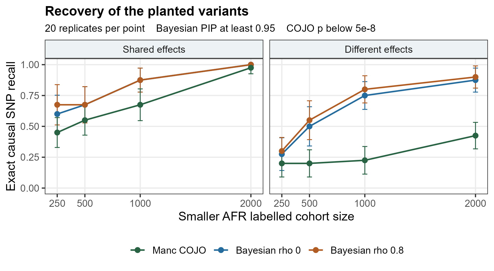
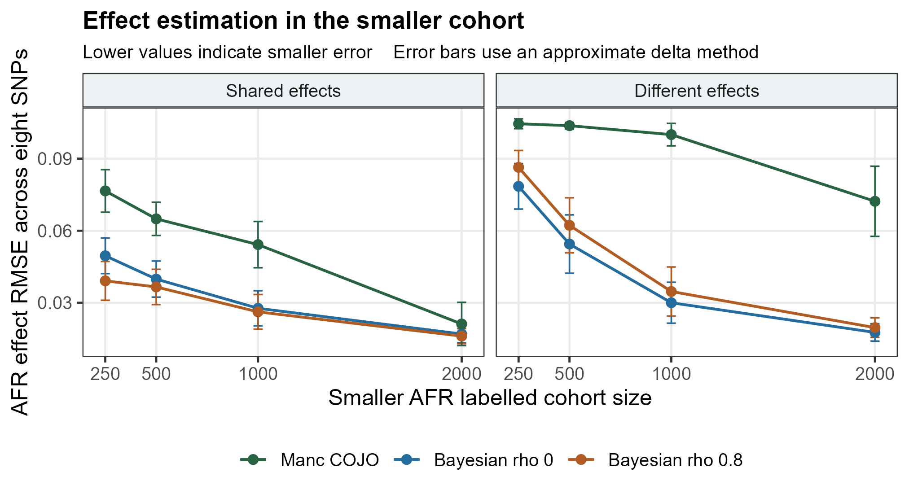
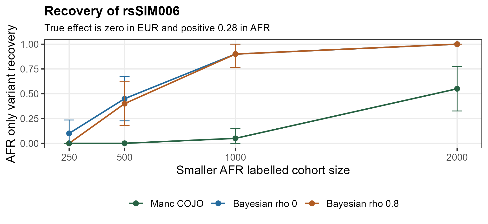
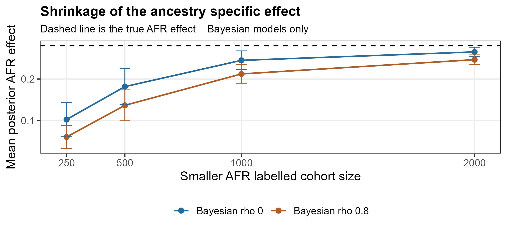

# Cross-population borrowing and effect heterogeneity in simulated genetic association studies

**Vusumuzi Mabasa**

**A paired comparison of Manc-COJO and Bayesian hierarchical variable selection**

All participants, genotypes and phenotypes are synthetic. EUR and AFR label simplified simulation settings, not sampled populations or the diversity within ancestry groups. No AWI-Gen or other participant-level research data were used.

[Word manuscript](report/Multiancestry_GWAS_Methodology_and_Results.docx) · [Results tables](results/summary.tsv) · [Paired comparisons](results/paired_differences.tsv) · [Reproduce the study](#reproducibility)

## Abstract

**Background.** Combining association evidence across populations can improve inference when effects are shared, but borrowing may distort effects that differ between populations. Unequal sample sizes and linkage disequilibrium (LD) complicate this trade-off.

**Methods.** We evaluated 240 paired dataset settings spanning three effect scenarios, four smaller-cohort sample sizes and 20 replicates per setting. Each dataset contained eight variants in two LD blocks. The EUR-labelled cohort contained 2,000 individuals; AFR-labelled samples contained 250–2,000. The official Manc-COJO v1.1.0 executable was compared with a custom Bayesian model using shared variant inclusion and effect correlations of 0 or 0.8. Both approaches received the same marginal statistics and in-sample LD.

**Results.** With shared effects and AFR sample size 250, strong borrowing reduced AFR effect RMSE from 0.050 to 0.039 relative to the uncorrelated-effect prior. Under heterogeneous effects, RMSE instead increased from 0.078 to 0.086. For an AFR-specific variant with true effect 0.28, mean posterior effects were 0.103 without effect correlation and 0.061 with strong borrowing. Recovery improved with sample size. No null false selections occurred under the primary thresholds, but only 20 null replicates were available per sample size.

**Conclusion.** Borrowing improved estimation when its assumptions matched the generating model and increased shrinkage of a population-specific effect when they did not. Differing selection thresholds and objectives preclude a general claim of method superiority.

## Introduction

Multi-population association analyses balance shared evidence against effect heterogeneity. A larger cohort may stabilise estimates in a smaller cohort, while differences in LD alter how marginal associations identify underlying signals. Strong similarity assumptions can also attenuate effects present primarily in the smaller cohort.

This study examines how sample size, LD and an explicit borrowing prior affect signal recovery and estimation when the truth is known. Manc-COJO provides the conditional-and-joint association comparator. The Bayesian analysis is a custom, exactly enumerated variable-selection model, not an implementation of MESuSiE or a validated new fine-mapping method. The objective is to characterise small-locus behaviour under controlled assumptions rather than benchmark genome-wide performance.

## Methods

### Simulation design

The design is recorded in [study_config.json](results/study_config.json); the generator and estimators are implemented in [simulate_compare.py](scripts/simulate_compare.py).

| Component | Specification |
|---|---|
| Variant panel | Eight biallelic variants in two independent four-variant blocks |
| Larger cohort | 2,000 EUR-labelled individuals |
| Smaller cohort | 250, 500, 1,000 or 2,000 AFR-labelled individuals |
| Allele frequency | 0.30 in both cohorts |
| Haplotype persistence | 0.80 in EUR; 0.35 in AFR |
| Replication | 20 replicates per scenario and sample size; 240 paired dataset settings |
| Seed | 20261026, with scenario- and replicate-specific random streams |
| Inputs | Identical marginal association statistics and in-sample LD for both approaches |

Two haplotypes were generated per individual. At the first variant of each block, alleles were Bernoulli(0.30) draws. Subsequent variants retained the preceding allele with the cohort-specific persistence probability or received a fresh Bernoulli draw. Genotype dosage summed the two haplotypes. This persistence parameter is distinct from the Bayesian effect correlation below.

For centred genotype matrix $X_k$, cohort $k$ phenotypes followed

$$
y_k=X_k\beta_k+\varepsilon_k,\qquad \varepsilon_k\sim N(0,I_{n_k}).
$$

All variants other than those listed below had zero generating effects.

| Scenario | rsSIM002 EUR | rsSIM002 AFR | rsSIM006 EUR | rsSIM006 AFR |
|---|---:|---:|---:|---:|
| Shared effects | 0.18 | 0.18 | −0.16 | −0.16 |
| Heterogeneous effects | 0.18 | 0.09 | 0.00 | 0.28 |
| Null | 0.00 | 0.00 | 0.00 | 0.00 |

Within each scenario and replicate, the EUR cohort was reused across sample sizes and AFR samples were nested subsets of the same 2,000 individuals. Thus the 240 settings are not 240 independent experiments. Cohorts did not overlap. Relatives, missing genotypes, stratification, admixture and external LD-reference mismatch were not simulated. Equal allele frequencies help isolate sample-size and LD effects but do not reproduce real population diversity.

### Summary-data likelihood

With centred phenotypes, define $Q_k=X_k^TX_k$, $q_k=X_k^Ty_k$ and $d_{jk}=(Q_k)_{jj}$. Marginal estimates and standard errors came from single-variant regression. Sufficient statistics were reconstructed from those summaries, LD matrix $R_k$ and exact in-sample genotype sums of squares:

$$
(Q_k)_{ij}=(R_k)_{ij}\sqrt{d_{ik}d_{jk}},\qquad (q_k)_j=d_{jk}\widehat b_{jk}.
$$

The phenotype sum of squares was reconstructed as the median across variants of $(n_k-2)d_{jk}\operatorname{SE}(\widehat b_{jk})^2+d_{jk}\widehat b_{jk}^{\,2}$. Residual variance was then estimated from the full eight-variant regression:

$$
\widehat\sigma_k^2=\frac{S_{yy,k}-q_k^TQ_k^{-1}q_k}{n_k-8-1}.
$$

This variance was held fixed. The analysis is therefore conditional on plug-in residual variances and fixed priors; it does not integrate their uncertainty. This likelihood is appropriate to the specified quantitative linear model, not a drop-in likelihood for binary or survival GWAS.

### Bayesian hierarchy and exact inference

Each variant had a shared indicator $\gamma_j\sim\operatorname{Bernoulli}(0.2)$. Exclusion set both cohort effects to zero. Included effects followed

$$
\beta_{jk}=\mu_j+\delta_{jk},\qquad
\mu_j\sim N(0,\rho\tau^2),\qquad
\delta_{jk}\sim N(0,(1-\rho)\tau^2),\qquad \tau=0.15.
$$

Strong borrowing used $\rho=0.8$; the sensitivity specification used $\rho=0$. The latter removes effect correlation but retains shared inclusion, so it is not a fully separate-cohort analysis. Inclusion identifies the union of signals and cannot assign separate probabilities of a zero effect within each cohort.

All $2^8=256$ configurations were enumerated. For active set $S$, effects ordered by cohort had covariance

$$
V_S=\tau^2\begin{pmatrix}I&\rho I\\\rho I&I\end{pmatrix}.
$$

Define $A_S=\operatorname{blockdiag}(Q_{1,SS}/\widehat\sigma_1^2,Q_{2,SS}/\widehat\sigma_2^2)$ and let $u_S$ stack $q_{k,S}/\widehat\sigma_k^2$ over cohorts. Conditional posterior covariance and mean were

$$
C_S=(V_S^{-1}+A_S)^{-1},\qquad m_S=C_Su_S.
$$

Gaussian integration yielded configuration weights relative to the null:

$$
w_S\propto 0.2^{|S|}0.8^{8-|S|}|V_S|^{-1/2}|V_S^{-1}+A_S|^{-1/2}
\exp\left(\tfrac12u_S^TC_Su_S\right).
$$

Normalised weights gave posterior inclusion probabilities (PIPs) and model-averaged effects. Posterior SDs include within- and between-configuration uncertainty; they are not credible-interval endpoints. No MCMC was required. Primary selection used PIP ≥ 0.95, with PIP ≥ 0.50 as sensitivity analysis. Effect estimates did not depend on the reporting threshold.

### Manc-COJO comparator

The completed run used the official Windows Manc-COJO v1.1.0 executable, with URL and SHA256 in [tools/provenance.json](tools/provenance.json). PLINK BED references and `.ma` files were supplied in EUR, AFR order. BIM A1 and summary effect alleles were A. Commands used `--cojo-slct --cojo-p 5e-8 --thread-num 1`, retaining other defaults.

Manc-COJO's stepwise meta-analysis criterion and the Bayesian shared-inclusion criterion differ. P-value and PIP thresholds were not calibrated to equal frequentist error rates. Recall differences at these settings cannot establish superior power at a common false-positive rate.

### Outcomes and Monte Carlo uncertainty

Exact recall was the fraction of planted causal variants selected. False discovery proportion was $\mathrm{FP}/\max(1,\mathrm{TP}+\mathrm{FP})$, with zero assigned when nothing was selected. We also recorded any false selection, AFR-specific variant recovery and causal-block recall. The latter counted any selected variant in a causal four-variant block; it is a permissive proxy measure, not formal LD-based signal matching or credible-set coverage.

For replicate $r$, AFR effect error was averaged over all eight variants. Displayed RMSE is the square root of mean replicate MSE:

$$
\mathrm{MSE}_r=\frac18\sum_{j=1}^{8}(\widehat\beta_{jr}-\beta_j)^2,
\qquad \mathrm{RMSE}=\sqrt{\frac1{20}\sum_{r=1}^{20}\mathrm{MSE}_r}.
$$

Unselected Manc-COJO effects were assigned zero to define a whole-locus estimator. Bayesian MSE used all posterior means. EUR and causal-only AFR errors are also exported. Across replicates, $\mathrm{MCSE}(\bar a)=s_a/\sqrt{20}$; paired differences used identical datasets. Figures show approximately ±1.96 MCSE, with recall bounds clipped to [0,1] and RMSE intervals obtained by the delta method. These describe simulation precision, not uncertainty in real-world effects.

## Results

### Signal recovery increased with sample size

With shared effects and AFR sample size 250, exact recall was 0.450 for Manc-COJO, 0.600 for the uncorrelated-effect prior and 0.675 for strong borrowing. At sample size 2,000, recall reached 0.975, 1.000 and 1.000. Under heterogeneous effects, the corresponding largest-sample values were 0.425, 0.875 and 0.900. These contrasts combine different models, selection objectives and thresholds. Exact recovery also penalises selection of correlated proxies.



*Figure 1. Mean exact recall across 20 replicates per point, with Monte Carlo error bars. Bayesian selection uses PIP ≥ 0.95; Manc-COJO uses its 5 × 10⁻⁸ selection threshold.*

The endpoint settings illustrate the sample-size gradient and the distinction between recovery and estimation. AFR RMSE below includes all eight effects, including null variants.

| Scenario | AFR N | Method | Exact recall | AFR RMSE | Mean FDP |
|---|---:|---|---:|---:|---:|
| Shared | 250 | Manc-COJO | 0.450 | 0.077 | 0.000 |
| Shared | 250 | Bayesian ρ = 0 | 0.600 | 0.050 | 0.000 |
| Shared | 250 | Bayesian ρ = 0.8 | 0.675 | 0.039 | 0.000 |
| Shared | 2,000 | Manc-COJO | 0.975 | 0.021 | 0.000 |
| Shared | 2,000 | Bayesian ρ = 0 | 1.000 | 0.017 | 0.000 |
| Shared | 2,000 | Bayesian ρ = 0.8 | 1.000 | 0.016 | 0.000 |
| Heterogeneous | 250 | Manc-COJO | 0.200 | 0.105 | 0.000 |
| Heterogeneous | 250 | Bayesian ρ = 0 | 0.275 | 0.078 | 0.025 |
| Heterogeneous | 250 | Bayesian ρ = 0.8 | 0.300 | 0.086 | 0.050 |
| Heterogeneous | 2,000 | Manc-COJO | 0.425 | 0.072 | 0.000 |
| Heterogeneous | 2,000 | Bayesian ρ = 0 | 0.875 | 0.018 | 0.000 |
| Heterogeneous | 2,000 | Bayesian ρ = 0.8 | 0.900 | 0.020 | 0.000 |

*Table 1. Selected primary-threshold results. All sample sizes, thresholds, metrics and MCSEs are in [summary.tsv](results/summary.tsv).*

### The benefit of borrowing depended on effect similarity

At AFR sample size 250, strong borrowing lowered RMSE from 0.050 to 0.039 under shared effects but raised it from 0.078 to 0.086 under heterogeneous effects. The same direction persisted at sample size 2,000, although errors were smaller. Borrowing improved estimation when similarity was correctly assumed; the uncorrelated-effect prior better preserved heterogeneous effects in this experiment.



*Figure 2. AFR whole-locus RMSE with delta-method Monte Carlo error bars. Posterior-mean RMSE is identical at both Bayesian PIP reporting thresholds.*

### Recovery and shrinkage of the AFR-specific variant were distinct outcomes

In the heterogeneous scenario, rsSIM006 had effect zero in EUR and 0.28 in AFR. At AFR sample size 250, it was recovered in 10% of replicates under the uncorrelated-effect prior and in none with strong borrowing or Manc-COJO. At sample size 2,000, recovery was 100% under both Bayesian priors and 55% under Manc-COJO. Increasing sample size improved selection, but selection alone did not establish accurate estimation.



*Figure 3. Selection frequency for rsSIM006 under heterogeneous effects; 20 replicates per sample size.*

Strong borrowing attenuated the AFR-specific effect more at every sample size. At N = 250, the mean posterior effect was 0.061 with ρ = 0.8 versus 0.103 with ρ = 0, both below the true effect of 0.28. At N = 2,000, means increased to 0.247 and 0.265. These averages include all replicates regardless of selection and demonstrate why recall should be interpreted alongside effect estimates.



*Figure 4. Mean model-averaged AFR effect for rsSIM006. The dashed line marks truth; error bars describe Monte Carlo uncertainty. Values are available in [afr_specific_posterior_means.tsv](results/afr_specific_posterior_means.tsv).*

### Null results depended on the reporting threshold

At PIP ≥ 0.95, neither Bayesian specification selected variants in any null replicate; Manc-COJO also made no null selections. At PIP ≥ 0.50, false selections occurred in up to 3 of 20 replicates. Zero events among 20 independent replicates gives a one-sided 95% binomial upper bound of $1-0.05^{1/20}=0.139$. This cannot establish genome-wide calibration. Counts across sample sizes cannot be pooled as independent observations because cohorts are nested.

| Replicates with any null false selection | AFR N = 250 | 500 | 1,000 | 2,000 |
|---|---:|---:|---:|---:|
| Manc-COJO | 0/20 | 0/20 | 0/20 | 0/20 |
| Bayesian ρ = 0, PIP ≥ 0.95 | 0/20 | 0/20 | 0/20 | 0/20 |
| Bayesian ρ = 0.8, PIP ≥ 0.95 | 0/20 | 0/20 | 0/20 | 0/20 |
| Bayesian ρ = 0, PIP ≥ 0.50 | 0/20 | 2/20 | 3/20 | 2/20 |
| Bayesian ρ = 0.8, PIP ≥ 0.50 | 0/20 | 1/20 | 2/20 | 2/20 |

*Table 2. False-selection counts from [null_event_counts.tsv](results/null_event_counts.tsv).*

The paired design also quantifies uncertainty in method differences. For shared effects at N = 250, strong borrowing minus Manc-COJO gave an exact-recall difference of 0.225 with MCSE 0.092. This describes variability in the observed contrast without resolving the unmatched-threshold limitation. Full paired estimates are in [paired_differences.tsv](results/paired_differences.tsv).

## Discussion

The central result is a conditional trade-off: an effect-correlation prior can stabilise estimates when effects are shared, yet pull a smaller-cohort-specific effect toward the larger cohort when effects differ. Increasing the smaller cohort's sample size improved recovery and estimation but did not remove every consequence of the prior. Because ρ = 0 retains shared inclusion, this comparison isolates effect-correlation assumptions within the hierarchy rather than contrasting pooling with completely independent analyses.

Comparisons with Manc-COJO require attention to the estimand. Exact causal-variant recall is narrower than recovery of an associated region, and zero-filled selected effects differ from continuous model averaging. Thresholds were not matched for error rates. The observed differences therefore cannot establish that one method is generally more powerful or better calibrated.

The simulation uses favourable inputs: a tiny locus, known allele alignment, equal allele frequencies, in-sample LD and a Gaussian outcome. Real studies may involve reference mismatch, stratification, relatedness, admixture, overlap and more complex genetic architectures. Fixed priors and plug-in variances omit further uncertainty. Twenty replicates yield coarse estimates, and runtimes at eight variants reflect implementation and input/output overhead rather than scalability.

A broader evaluation would require more independent replicates, calibrated decision thresholds, realistic LD and frequency variation, external-reference mismatch, ancestry-specific inclusion and formal signal matching. These extensions were not tested here.

## Conclusion

The usefulness of cross-population effect borrowing depended on effect similarity and information in the smaller cohort. Recovery, estimation error and ancestry-specific shrinkage offered complementary evidence. This reproducible synthetic study supports examination of modelling assumptions and computational behaviour, not biological conclusions about real populations or a general ranking of methods.

## Reproducibility

The repository includes source code, 1,200 replicate-level method/threshold records, 3,840 Bayesian variant records, summaries, figures and the [Word manuscript](report/Multiancestry_GWAS_Methodology_and_Results.docx). Five reporting combinations were evaluated per dataset: Manc-COJO and two Bayesian correlations at two thresholds. Bayesian thresholds share the same fitted posterior. Generated inputs, detailed logs, third-party executables and machine-specific paths are excluded from Git.

The recorded run used Python 3.12.14, NumPy 2.3.5, Manc-COJO v1.1.0, R 4.3.3 for base summaries and R 4.5.1 for Word authoring. See [runtime_and_validation.json](results/runtime_and_validation.json), [requirements.txt](requirements.txt), [software provenance](tools/provenance.json) and [public checksums](checksums_public.sha256).

Use an existing Python environment with the specified NumPy version and R with `officer`, `flextable`, `ggplot2`, `jsonlite`, `xml2` and `zip`. Obtain the appropriate executable from the [official release](https://github.com/light156/multi-ancestry-COJO/releases/tag/v1.1.0). Scripts do not install dependencies. From the repository root:

```bash
python scripts/validate.py

# Linux executable with Linux Python
python scripts/simulate_compare.py --replicates 20 --seed 20261026 --manc tools/manc_cojo

# On Windows, use this simulation command instead
# python scripts/simulate_compare.py --replicates 20 --seed 20261026 --manc tools/manc_cojo_win.exe

Rscript scripts/report.R
Rscript scripts/build_word_report.R
python scripts/audit_results.py
```

Simulation commands replace generated inputs and results in this checkout. Omitting `--manc` produces status `BAYES_ONLY_MANC_NOT_RUN`, not a completed comparison. To add Manc-COJO to existing generated datasets, run `python scripts/run_manc_existing.py --manc tools/manc_cojo_win.exe` on Windows, or supply the Linux executable on Linux, then regenerate summaries and the Word report.

`validate.py` checks BED dosage encoding, summary-likelihood reconstruction, an analytic posterior calculation and cohort-swap symmetry. The recorded full audit checks result completeness, finite errors, PIP bounds, allele orientation, selected joint P-values and actual executable logs. `audit_results.py` requires regenerated local `results/config.json` and per-dataset logs; it is not a checksum-only check of a fresh public clone. These checks assess implementation, not real-data validity.

## References

- [Manc-COJO methodological paper](https://doi.org/10.1038/s41588-026-02799-1).
- [Official Manc-COJO tutorial](https://light156.github.io/multi-ancestry-COJO-docs/tutorial/) and [command options](https://light156.github.io/multi-ancestry-COJO-docs/options/).
- [Official Manc-COJO source and releases](https://github.com/light156/multi-ancestry-COJO).
- [MESuSiE](https://doi.org/10.1038/s41588-023-01604-7), a related established Bayesian approach; the custom hierarchy here does not implement this method.
